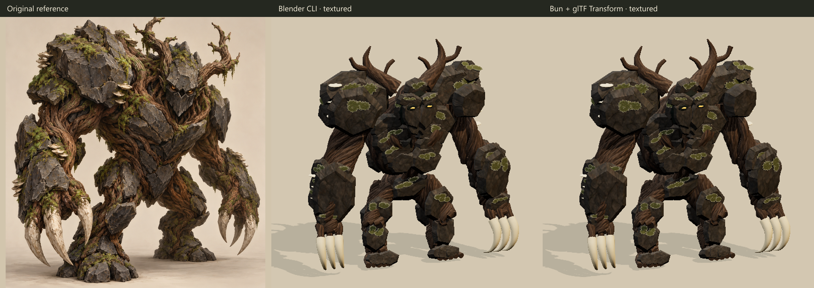

# glb-creator: Codex monster demo

A standalone reproduction of the Blender CLI versus Bun/glTF Transform experiment. It consumes the [glb-creator skill](https://github.com/asilvas/skill-glb-creator) as a package dependency and has its own Blender launcher. No game checkout, Blender MCP, Codex account, or image-generation service is required to run the demo.



## Recorded results

The October 16, 2026 experiment measured three alternating fresh-process trials per pipeline. Each trial built/exported the textured monster and rendered five 512px poses into memory.

| Metric | Blender CLI | Bun + native renderer |
|---|---:|---:|
| Median build/export + five previews | 13.48 s | **3.29 s** |
| Warm frame median | 317.59 ms | **123.26 ms** |
| Final GLB bytes | 12,330,052 | 12,470,924 |
| Triangles | 80,694 | 80,694 |
| Embedded PBR images | 12 | 12 |
| Khronos errors / warnings | 0 / 0 | 0 / 0 |

**4.10× faster runtime iteration** on the measured Windows/Ryzen 9 9950X3D host with RTX 5090 adapters and Bun 1.4.4-canary.1 / Blender 5.2.1. Both exports contain nine joints and exactly one 1.2-second attack. Blender skips optional `.blend` checkpoints and stops timing at its in-memory Render Result; Bun includes GPU readback and PNG encoding. Different renderers, lights, export details and interpolation remain confounds. The selected GPU and unrelated workload were not independently controlled.

This demonstrates a local runtime advantage. **Lower total agent-token cost and reference-quality parity remain unproven.** The reconstruction is a procedural interpretation with simpler forms and surface integration than the painted reference.

The original rgl API and CLI tests both failed with Dawn startup exit code 3 before rendering. `@headless-three/renderer` 0.4.5 was the working choice. The reproduction tests both candidates again; failure is recorded rather than treated as a speed score.

[Compact metrics](performance.json), [raw trials](benchmark-results.json), [renderer failure logs](renderer-failures.txt), and [original application-specific review](validation.json) preserve the initial evidence. `recorded-sources/` preserves the exact measured text sources for hash verification. Those snapshots are historical evidence; current scripts use the separate skill package and local Blender support. New runs may differ after the repository split and on other hardware.

## Assets and inputs

- [Bun GLB](bun-monster.glb), [1024px portrait](bun-monster.png), [attack animation](bun-attack.webp).
- [Blender GLB](blender-monster.glb), [1024px portrait](blender-monster.png), [attack animation](blender-attack.webp).
- [Reference](reference.png) and [generation provenance](reference-provenance.json).
- Source [stone](textures/stone.jpg), [bark](textures/bark.jpg), [moss](textures/moss.jpg), [ivory](textures/ivory.jpg), and [prepared material manifest](textures/materials.json).

All four source images, twelve prepared albedo/normal/roughness maps, prompts, provider receipts and generation timings are retained in `textures/`. `bun run materials` deterministically regenerates the prepared maps. Normals are approximations from albedo gradients, not scans. Original texture generation used grok-imagine outside the skill: about 253 seconds and an estimated $0.24 shared by both pipelines. Reproduction makes no paid image-generation calls.

## Run it

Install Git, Bun and Blender 5.2. Native renderer compatibility on other OS/runtime combinations needs verification. Clone these repositories beside each other:

```sh
git clone https://github.com/asilvas/skill-glb-creator
git clone https://github.com/asilvas/skill-glb-creator-codex-demo
cd skill-glb-creator-codex-demo
bun run setup
bun run check
bun run test
bun run benchmark
bun run review
bun run report
```

The `file:../skill-glb-creator` dependency is intentional: it tests the actual skill source, works before publication, and avoids copying a second live implementation into this repository. Setup installs both packages; no absolute developer path is required. Rerun setup after editing the skill. To install the agent skill separately, use `npx skills add https://github.com/asilvas/skill-glb-creator`.

Set `BLENDER_BIN` to the actual Blender executable if it is not on PATH. Windows also detects the standard Blender 5.2 installation. A different version requires `GLB_DEMO_ALLOW_BLENDER_VERSION=1` and is recorded in receipts. Every run starts background/factory-startup Blender with a hidden window, isolated preferences, full logs, a timeout and an exact PID. It requests lower process priority where supported.

`bun run build` writes the Bun model under `tmp/`; `bun run baseline` builds the independent Blender model and saves optional authoring history. `bun run benchmark` alternates three fresh trials and freezes source/input hashes, GLBs and optional inspection captures. Timing uses memory previews. `bun run review` validates exported bytes and re-imports each model in fresh Blender, evaluating motion, recovery and grounding over the whole attack.

New results appear under `tmp/bench-*/` and `tmp/report/`. The report includes comparison PNGs, portraits, animated WebPs, timings and GLB sizes. Checked-in evidence stays unchanged. `bun run retain` explicitly replaces retained outputs, reviews and measured source snapshots; update this README's numbers if publishing that new run. Add `-- --out-dir=tmp/my-run` to retain a separate scratch copy. Inputs stay at the repository root and in `textures/`, outside scratch cleanup.

Tests cover texture regeneration, visible pixel ablations, deterministic export, skin deformation, pose recovery, framing and capture boundaries. The skill repository tests its generic tools and detached cleanup separately. Optional manually supplied token counters can be read from a JSON file via `GLB_DEMO_TOKEN_USAGE`; no private chat logs are inspected. Source-token counts are proxies and do not establish billed agent usage.

[MIT license](LICENSE).
